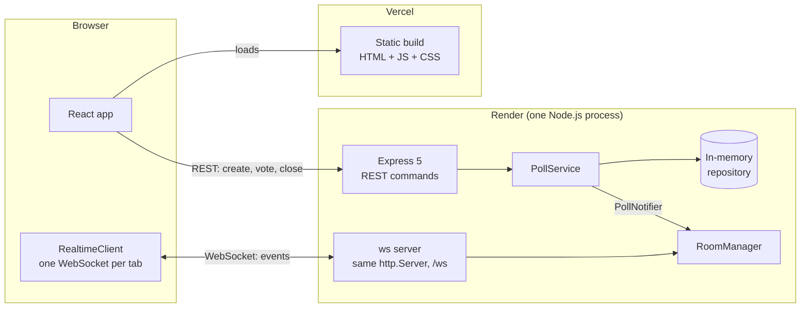
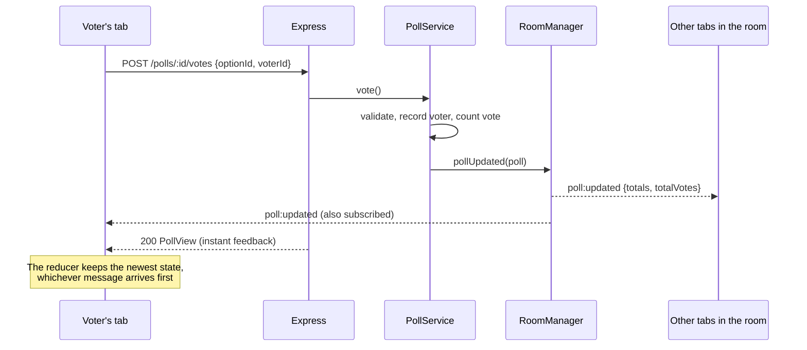

# Live Poll

Create a poll, share the link, and watch the votes arrive on every screen in real time, with no refresh. Built with **Express 5** and the plain **`ws`** library on the backend (rooms, heartbeat and rate limits are written by hand) and **React 19** on the frontend.

**Live demo:** https://YOUR-APP.vercel.app · _the API runs on a free tier, so the first visit may take up to a minute while it wakes up._


## Features

- **Live results:** every vote moves the bars on every open screen, and you can see how many people are watching.
- **Share anywhere:** copy the short link or show a QR code. **Presentation mode** puts the results full screen with a QR code for the audience.
- **Admin link:** the creator gets a private link (`/p/:id#admin=…`) to close the poll from any device.
- **Resilient connection:** reconnects automatically with exponential backoff and jitter, and subscribes to the poll again after reconnecting.
- **Honest about cold starts:** a banner explains when the free-tier server is waking up, instead of a page that looks broken.
- **Protected API:** input validation, size limits, per-IP rate limits, an Origin check on WebSocket upgrades, and a per-connection message limit.
- **Accessible UI** in light and dark mode, following the operating system setting.

## Architecture



The backend uses **ports and adapters**. `PollService` holds the business rules and only knows the `PollNotifier` interface. The WebSocket layer implements that interface, so the service can be tested with a fake notifier and no sockets at all.

### What happens when someone votes



## Tech decisions

| Decision | Why |
|---|---|
| **Plain `ws`, not Socket.IO** | Rooms, heartbeat, reconnection and re-subscription are the interesting parts, so they are written by hand. The whole `api/src/ws/` folder is about 350 lines, comments included, with no hidden protocol. |
| **REST for commands, WebSocket only for events** | Votes and closes get status codes, validation errors and an immediate response. The socket only pushes changes, which keeps the protocol tiny. |
| **Shared contracts without a package** | `shared/` holds only types and constants, imported by path from both sides. If the API changes a message, the frontend stops compiling. There is no publishing step and no workspace setup. |
| **No state library** | One `useReducer` per poll page merges the REST and WebSocket sources. It is a pure function that is easy to test, and it never lets results go backwards (votes only grow, a closed poll never reopens). |
| **CSS-only bar chart** | Each bar's width is its percentage, and `transition-[width]` animates it. No chart library is needed. |
| **Zod on the API** | One tool validates request bodies, WebSocket messages, environment variables and seed data. The schemas are checked against the shared types with `satisfies`. |
| **Admin token in the URL fragment** | Browsers never send `#…` to the server, so the token stays out of logs and `Referer` headers. The page saves it and removes it from the address bar. |
| **Biome** | Lint and format in one fast tool, with one config for the whole repo. |

## Real-time protocol

Clients connect to `wss://<api>/ws`. Every message is JSON with a `type` field (types: [`shared/ws.ts`](shared/ws.ts)).

| Direction | Message | Meaning |
|---|---|---|
| client → server | `subscribe {pollId}` | Join the poll's room (leaves the previous one). Answered with `poll:snapshot`. |
| client → server | `unsubscribe {pollId}` | Leave the room. |
| server → client | `poll:snapshot {poll}` | Full current state, sent right after subscribing. |
| server → client | `poll:updated {pollId, totals, totalVotes}` | Someone voted. |
| server → client | `poll:closed {pollId}` | The admin closed the poll. |
| server → client | `poll:removed {pollId}` | The poll was evicted to free memory. |
| server → client | `viewers {pollId, count}` | Number of connections in the room changed. |
| server → client | `error {code, message}` | `INVALID_MESSAGE`, `POLL_NOT_FOUND` or `RATE_LIMITED`. |

Close codes: **1008** when a client keeps exceeding the message limit (the client does not reconnect), **1009** for messages over 1 KB, **1011** for an unexpected server error, and **1001** when the server shuts down (the client reconnects).

The server pings every connection every 30 s and terminates the ones that do not answer.

## Limits & trade-offs

| | Default | Env var |
|---|---|---|
| Question / options | 3–200 chars; 2–6 options of up to 80 chars, no duplicates | (in [`shared/limits.ts`](shared/limits.ts)) |
| Polls in memory | 500 user polls; the oldest is evicted, seed polls never are | `MAX_POLLS` |
| Create poll | 5 per minute per IP | `RATE_LIMIT_CREATE_PER_MIN` |
| Vote | 30 per minute per IP | `RATE_LIMIT_VOTE_PER_MIN` |
| WebSocket messages | 20 per 10 s per connection | `WS_MESSAGES_PER_10S` |
| Body / WS message size | 10 KB / 1 KB | — |

What this project deliberately does **not** do:

- **No database.** Polls live in memory, so they disappear when the server restarts or sleeps. This is a demo of real-time plumbing, not of persistence.
- **Cold start.** Render's free tier spins the API down after 15 minutes without inbound traffic, and waking up takes about a minute. Messages on an open WebSocket count as traffic, so a tab left open on a poll can keep the server awake. Every deploy also closes all WebSocket connections, and clients reconnect on their own.
- **One vote per browser, not per person.** The voter ID is a random UUID in `localStorage`. A private window can vote again, and real fraud prevention needs accounts.
- **Viewers = connections.** Two tabs count as two viewers.
- **One instance.** Rooms and rate-limit counters are in process memory. Scaling out would need a shared store (for example Redis pub/sub), which is out of scope.
- **IP-based rate limits** group IPv6 clients by their /64 prefix, so one household cannot rotate through addresses. Several people behind the same NAT share one limit.

## Running locally

Requires **Node.js 24** (see [`.nvmrc`](.nvmrc)).

```bash
npm run install:all          # installs the root (Biome), api/ and web/

npm run dev --prefix api     # API on http://localhost:3000
npm run dev --prefix web     # web on http://localhost:5173
```

The defaults work out of the box. To change them, copy [`api/.env.example`](api/.env.example) to `api/.env` and [`web/.env.example`](web/.env.example) to `web/.env.local`.

A production build of `web/` requires `VITE_API_URL` and `VITE_WS_URL`, and fails without them.

## Testing

```bash
npm run lint                                              # Biome, whole repo
npm run typecheck --prefix api && npm test --prefix api   # ~150 tests
npm run typecheck --prefix web && npm test --prefix web   # ~115 tests
```

All tests use **Vitest**, and CI runs them on pushes to `main` and on pull requests ([`.github/workflows/ci.yml`](.github/workflows/ci.yml)).

- **API unit tests** cover the domain, service, repository, schemas, rate limiter and message limiter. They use hand-written fakes and an injected clock, so nothing waits for real time.
- **API integration tests** start the real server on port 0 and talk to it with `fetch` and real WebSocket clients: CORS, error format, rate limits with `Retry-After`, rooms, broadcasts, heartbeat, Origin check and close codes.
- **Web unit tests** cover the reducer, `RealtimeClient` (backoff, jitter, re-subscribe, stale sockets), storage, links and HTTP wrapper.
- **Web page tests** render the whole app with **Testing Library** and `userEvent`:
  - `fetch` is mocked by route.
  - The WebSocket is a hand-written `FakeWebSocket` that the test drives (`open()`, `receive()`, `drop()`).
  - Fake timers cover reconnection backoff and the 90 s cold-start flow.
- The tests were checked by **mutation**: each rule was broken on purpose to confirm that a test fails.

## Project structure

```
shared/            Contracts used by both sides: types and constants only, no dependencies
  api.ts           REST request/response types and error codes
  ws.ts            WebSocket messages
  limits.ts        Validation limits (Zod schemas and form inputs)

api/               Express 5 + ws (deployed to Render)
  src/domain/      Poll model, PollView mapping, AppError hierarchy
  src/services/    PollService (business rules) and the PollNotifier port
  src/repositories In-memory repository with eviction
  src/http/        App factory, routes, Zod schemas, middlewares (CORS, errors, rate limit, logging)
  src/ws/          Upgrade + Origin check, rooms, protocol, heartbeat, message limiter, notifier
  src/build-server.ts  Composition root; server.ts adds listen() and graceful shutdown
  test/            unit/ and integration/

web/               React 19 + Vite + Tailwind v4 + React Router (deployed to Vercel)
  src/app/         App, routes, RealtimeProvider, ServerStatusProvider
  src/pages/       Home, Poll, Present, NotFound
  src/features/polls/  Components, hooks (usePoll, useVote, …), reducer, API calls, storage
  src/lib/         HTTP wrapper, RealtimeClient, config, error messages
  src/components/  Generic UI: Button, Card, CopyButton, QrCode (lazy), banners
```

## License

[MIT](LICENSE)
